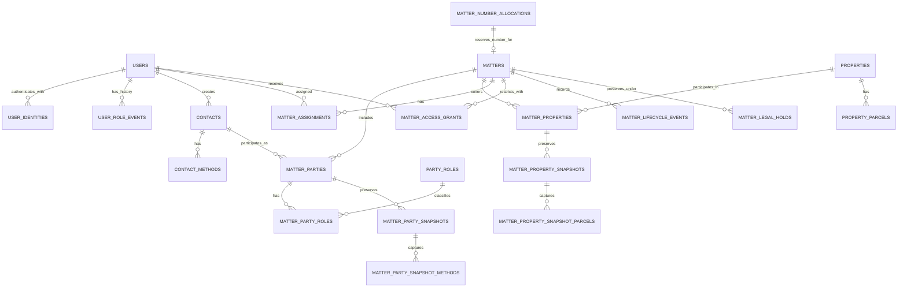
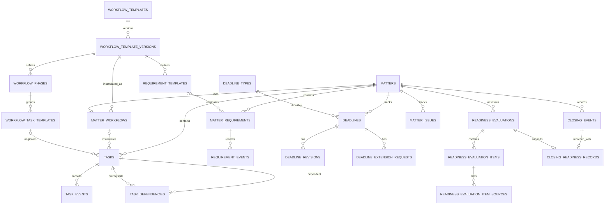

# Landholders Law — ERD and initial PostgreSQL DDL

**Status:** Proposed documentation for review, 2026-11-07. The [data dictionary](Landholders_Law_PostgreSQL_Data_Dictionary.md) is the detailed design source; the [data model](Landholders_Law_PostgreSQL_Data_Model.md) supplies business context. Neither this ERD nor the [SQL draft](schema/001_foundation_draft.sql) is a production migration. These diagrams show principal entities and relationships, not every column, actor, event, or FK in the dictionary. Cardinalities describe the physical design, including incomplete drafts; activation and authorization add service-level requirements.

## Identity, contacts, and matters

A matter can have multiple clients and properties; a contact or property can recur across matters. A draft may have neither. At most one primary client and primary property are proposed; activation requires a client, primary property and authorized primary attorney, but does not require a primary client. Snapshots preserve matter-time details when reusable records change. A reference allocation is independently committed before matter creation; a unique foreign key links at most one matter to each allocation. See the numbering decision below.

## Workflow, deadlines, and closing

An activated matter has exactly one compatible workflow; a draft can have none. Manual tasks need not originate from templates. Task dependencies, requirement evidence, and other matter-scoped links must not cross matters. Deadline revisions preserve effective values; an extension request does not itself change the deadline. Readiness evaluations are historical snapshots, distinct from current readiness.

## Documents, review, and notifications

```mermaid
erDiagram
    MATTERS ||--o{ DOCUMENTS : contains
    DOCUMENT_CATEGORIES ||--o{ DOCUMENTS : classifies
    DOCUMENTS ||--o{ DOCUMENT_VERSIONS : has
    DOCUMENT_VERSIONS ||--o{ DOCUMENT_SCAN_EVENTS : records
    MATTER_REQUIREMENTS ||--o{ REQUIREMENT_EVIDENCE : supported_by
    DOCUMENT_VERSIONS o|--o{ REQUIREMENT_EVIDENCE : may_support
    MATTERS ||--o{ CORRESPONDENCE : contains
    CORRESPONDENCE ||--o{ CORRESPONDENCE_DRAFTS : revises
    CORRESPONDENCE_DRAFTS ||--o{ DRAFT_RECIPIENTS : addresses
    CORRESPONDENCE_DRAFTS ||--o{ DRAFT_ATTACHMENTS : attaches
    CORRESPONDENCE ||--o{ UNAPPROVED_SEND_INCIDENTS : reports
    UNAPPROVED_SEND_INCIDENTS ||--o{ UNAPPROVED_SEND_EVENTS : reviewed_by
    UNAPPROVED_SEND_INCIDENTS ||--o{ UNAPPROVED_SEND_FOLLOWUP_TASKS : has
    TASKS ||--o{ UNAPPROVED_SEND_FOLLOWUP_TASKS : follows_up
    DOCUMENT_VERSIONS ||--o{ DRAFT_ATTACHMENTS : referenced_by
    CORRESPONDENCE_DRAFTS o|--o{ APPROVAL_REQUESTS : review_target
    MATTERS ||--o{ EXCEPTION_REQUESTS : contains
    EXCEPTION_REQUESTS ||--o{ EXCEPTION_REVISIONS : revises
    EXCEPTION_REVISIONS o|--o{ APPROVAL_REQUESTS : review_target
    EXCEPTION_REVISIONS ||--o{ EXCEPTION_TARGETS : identifies
    APPROVAL_REQUESTS ||--o| APPROVAL_DECISIONS : decided_by
    CORRESPONDENCE ||--o{ CORRESPONDENCE_SENDS : records
    CORRESPONDENCE_SENDS ||--o{ CORRESPONDENCE_SEND_RECIPIENTS : addresses
    CORRESPONDENCE_SENDS ||--o{ CORRESPONDENCE_SEND_EVIDENCE : retains
    APPROVAL_DECISIONS ||--o| APPROVAL_REVOCATIONS : revoked_by
    APPROVAL_DECISIONS ||--o{ CORRESPONDENCE_MATERIALITY_DECISIONS : extended_by
    CORRESPONDENCE_DRAFTS ||--o{ CORRESPONDENCE_MATERIALITY_DECISIONS : assessed
    DEADLINES ||--o{ REMINDER_OCCURRENCES : schedules
    DEADLINE_REVISIONS ||--o{ REMINDER_OCCURRENCES : schedules_revision
    REMINDER_OCCURRENCES ||--o{ REMINDER_OCCURRENCE_REASONS : triggered_by
    MATTERS ||--o{ NOTIFICATIONS : contains
    MATTERS ||--o{ TASK_ASSIGNMENT_EVENTS : records
    TASKS ||--o{ TASK_ASSIGNMENT_EVENTS : assigned_by
    MATTERS ||--o{ DEADLINE_ASSIGNMENT_EVENTS : records
    DEADLINES ||--o{ DEADLINE_ASSIGNMENT_EVENTS : assigned_by
    REMINDER_OCCURRENCES ||--o{ DELIVERY_ATTEMPTS : records
    REMINDER_OCCURRENCES o|--o| NOTIFICATIONS : may_create
    USERS ||--o{ NOTIFICATIONS : receives
    MATTERS o|--o{ AUDIT_EVENTS : may_record
    MATTERS o|--o{ OUTBOX_EVENTS : may_produce
```

Each approval request targets exactly one draft **or** exception revision; the diagram's two optional links must be combined with an exactly-one constraint. A document version represents an uploaded object or an external link, with mutually exclusive locators; upload scan history is separate. Recording a send and approval authorization require the service checks described in the dictionary. The application cannot prevent off-platform sending. Outbox delivery is asynchronous and does not guarantee exactly-once external delivery.

## First DDL draft

[001_foundation_draft.sql](schema/001_foundation_draft.sql) defines `users`, `user_identities`, `contacts`, `contact_methods`, `properties`, and `property_parcels`, plus an `updated_at` trigger. It targets PostgreSQL 16+ and follows the dictionary's single-firm, plural-table, bigint identity and app-generated UUID conventions. These are documentation artifacts, not migrations or evidence that a database is configured. [002_matters_draft.sql](schema/002_matters_draft.sql) adds number counters and allocations, matters, parties, property links, assignments, access grants and lifecycle events. [003_matter_snapshots_draft.sql](schema/003_matter_snapshots_draft.sql) adds matter-time contact and property snapshots. Apply the drafts in numeric order only in a disposable test database; none is an Alembic migration.

Database checks enforce nonblank required names and locators, supported identity/contact kinds, Illinois properties, positive known unit counts and row versions, unique provider identities, and at most one preferred contact method per kind. Foreign keys restrict deletion and have supporting leading-column indexes. Email, names, addresses, phone numbers and PINs are deliberately not unique: normalization and duplicate handling are unresolved. Unknown property condominium status and unit count remain nullable; optional name parts, contact labels, parcel county and last verification represent missing or inapplicable information.

The application supplies UUIDs, increments `row_version` using optimistic concurrency, verifies Workspace membership and current authorization, controls sandbox identities, and writes audit/role history atomically. The trigger maintains `updated_at`; `now()` is transaction time. These service controls and the dictionary's immutable-history privileges are not implemented by this SQL. Access patterns supported initially are provider/issuer/subject lookup, case-insensitive email or contact-name equality, contact methods by contact, properties by city, and parcels by property. Lowercase B-tree indexes do not provide arbitrary substring search. The dictionary assumes fewer than 500 matters per year; child volumes and write rates are unknown, so indexes need measurement.

## Recommended database decisions

These decisions refine the dictionary for implementation and remain subject to production review. The following choices do not establish legal retention periods or approve workflow rules.

| Decision | Recommended approach and rationale |
| --- | --- |
| Matter references | Reserve `(year, sequence)` in an independently committed transaction; retain the allocation even if matter creation fails. The matter references the allocation by unique FK, avoiding a second copy of the year and sequence. Gaps are acceptable; an allocation cannot be used by two matters. This intentionally replaces the dictionary's duplicated matter reference columns. |
| Retention and deletion | Restrict normal application deletion of matter and historical records; deactivate users and contacts. Use explicit privileges and audited administrative processes, not cascading deletes. Determine retention, legal holds and eventual disposal with the firm before production. FK restrictions alone do not prevent deleting unreferenced records. |
| Contact matching | Store original values. Show candidate matches using case-insensitive name/email comparisons and normalized phone digits, with staff confirmation; do not enforce global uniqueness or automatically merge. Normalize for search only and do not overwrite the original. Do not treat a match as proof of identity. |
| Parcel matching | Preserve the original PIN and county; compare digit-only PINs as a candidate search within a known county and flag missing county. Do not enforce uniqueness or merge automatically: formatting, county rules and parcel changes need review. |
| Parties and property | Reusable master records and matter join rows are distinct; matter-time snapshots retain the agreed name, methods, address and parcels. Allow multiple clients and properties, at most one primary of each; activation requires at least one client and a primary property. |
| Access and history | Use explicit matter grants for restricted matters, preserve ended assignments and lifecycle events, and perform authorization in the service on every read and write. Triggers protect lifecycle events, allocation and snapshot history and allow only one-way assignment ending and grant revocation. The DDL does not restrict reads; database privileges, audit writes and service checks are required. |
| Keys and indexes | Continue bigint identity for internal keys, application-supplied public UUIDs, named constraints, `timestamptz`, explicit restrictive foreign keys and indexed referencing columns. Add wider search indexes only after measuring representative queries. |

### Reservation protocol

The counter is a per-year row, not a PostgreSQL sequence. Within a **separate transaction**, the allocation service:

1. Takes a transaction-scoped advisory lock derived from the allocation token, then looks up the token. If found, returns that same allocation; retries must reuse the same token and originally selected year, even across New Year. Hash collisions merely serialize unrelated tokens. The caller must durably persist the token and chosen firm-local year before the first request; if an uncommitted attempt crosses New Year, the retry retains that chosen year.
2. If absent, validates the persisted year chosen in the configured firm timezone (currently America/Chicago), atomically increments that year's counter with `INSERT ... ON CONFLICT (reference_year) DO UPDATE SET last_value = matter_number_counters.last_value + 1 RETURNING last_value`, and inserts the allocation with the returned value and token. The counter row serializes concurrent allocations for the same year; different years can proceed independently. Both operations are in the reservation transaction.
3. Commits that transaction **before** exposing the reference or beginning matter creation. If the commit outcome is unknown, retry with the same token and read the result. A transaction rolled back before a reservation commits can reuse its counter value because no reference was issued. Once committed, the allocation is never deleted, changed or reissued, even if the subsequent matter transaction fails.
4. Creates the draft in a second transaction using the allocation's ID. A retry looks up the matter by its unique allocation ID and returns it rather than creating another. Use a stable matter public ID too. The FK and unique constraint prevent nonexistent allocations and duplicate attachment; service authorization must prevent claiming another request's allocation.

The initial counter insert uses `last_value = 1`. All allocators must follow this protocol, including the token lock before the counter lock. Use a dedicated reservation service/database role and revoke direct counter/allocation update and delete privileges from ordinary application roles; initial counter insert/update and allocation insert are limited to the reservation operation. [016_matter_reservation_draft.sql](schema/016_matter_reservation_draft.sql) implements the allocation operation using the caller’s transaction; it cannot commit independently or choose/authorize the firm-local year. Disposable PostgreSQL tests cover concurrent same-token and different-token calls, same-token races across years, independent year counters, backend termination before commit, retry after a confirmed commit followed by disconnect, a later failed matter transaction, and competing matter inserts for one allocation. The service must persist its token and year, commit the reservation independently, recover uncertain commit results, and restrict execution and direct table writes. An uncertain connection failure during the COMMIT response, actual firm-timezone year-boundary selection, production privileges and end-to-end service behavior remain unverified. Do not infer no-reuse from the FK alone.

### Snapshot and history controls

Each snapshot is inserted unsealed, its method or parcel children are inserted, and the header is sealed in the **same transaction**. Readers must use only sealed snapshots. Child inserts lock the header, so an insert racing a seal either completes before the seal or fails after it. Header data and child rows are immutable; a change creates a new revision. The service serializes revision allocation, captures the source values consistently, creates the initial snapshot when a party or property is added, and records corrections and audit events atomically. The schema permits an unsealed header to commit; monitoring and service logic must treat one as incomplete, and privileged repair is required if that happens. Snapshot creation/sealing and race behavior need real database tests.

Identity binding fields cannot be updated or deleted, though `last_verified_at` can be updated. Allocation rows and lifecycle events reject update/delete; a matter cannot be deleted or change its allocation. A party or property participation cannot be moved to another matter or master record, although primary/client flags can change. Assignments can only be ended once, and grants can only be revoked once. Revocation reasons and actor/time for ending an assignment require separate audit events in the same service transaction; the current assignment row has no ended-by column. Corrections to protected records require a controlled administrative procedure, audit, and potentially a migration; these triggers intentionally have no ordinary bypass. Production app roles must not own the tables or be able to disable triggers, change functions, or directly manipulate counters and allocations. Restrict insertion of identity bindings and sensitive records to authorized service paths. DDL does not implement those roles, authentication, access checks, event/audit writes, or snapshots' application workflow.

## Workflow DDL draft

[004_workflow_draft.sql](schema/004_workflow_draft.sql) adds workflow templates and versions, phases, task and requirement definitions, matter workflows, tasks and same-matter dependency edges. Versions begin as drafts; publication and child edits lock the version row, and published definitions are immutable. Matter workflow creation requires a published version matching the matter type. Standard tasks have same-matter workflow and same-version template foreign keys; manual tasks have no workflow provenance in this draft. This is a design choice pending the dictionary's manual-link decision.

The service must validate template contents and applicability-rule DSL before publication, authorize activation, create work and history atomically, manage task transitions and roles, validate timezones and local/instant consistency, and serialize dependency graph edits before cycle checks. The draft does not yet include task events, template validation history, task assignment history, rule evaluations, requirement execution, or review events. It does not prevent privileged database owners from disabling controls. Template identities are immutable immediately after creation, a stricter provisional rule than the dictionary. No workflow content is approved or seeded.

The disposable PostgreSQL 16 container applied the four draft SQL files and passed selected constraint/trigger checks; this does not verify concurrency, privileges, service operations, access control, or query plans.

## Additional DDL drafts

[005_documents_deadlines_draft.sql](schema/005_documents_deadlines_draft.sql) adds document categories, logical documents, immutable document versions and scan events; deadline types, current deadlines, immutable revisions, extension requests, closing events, issues and readiness assessments. Document locator checks require exactly one uploaded object or encrypted external locator. Deadline source documents use same-matter foreign keys.

[006_requirements_draft.sql](schema/006_requirements_draft.sql) adds financial confirmations and immutable revisions, matter requirements, and typed evidence links and events. Exactly one evidence target is required; composite foreign keys enforce matter consistency and template/workflow version consistency. Manual requirements have no template provenance in this draft, pending final policy.

[007_review_messaging_draft.sql](schema/007_review_messaging_draft.sql) adds correspondence and immutable drafts, exception requests and revisions, typed exception targets, approval requests and decisions, an outbox and audit events. Each approval request targets exactly one draft or exception revision; an index prevents duplicate pending requests per target. These tables alone are **not a complete correspondence approval system**: attorney authority, exact revision authorization, target freezing, lifecycle transitions, materiality/revocation, send tracking and atomic decisions are not implemented. Draft recipients, attachments and other correspondence records are added in draft 012. Do not use these drafts to authorize or record real sends.

Catalog management, Other descriptions, document scan gating, timezone validation, activation, change histories and current-state/event updates require service operations and access controls that are not implemented here. `ON DELETE RESTRICT` and append-only triggers are not a substitute for restricted database roles. No legal rules, retention periods, schedules or workflow seeds are approved by these drafts.

The disposable PostgreSQL 16 suite applies the SQL drafts and tests selected checks, unique and same-matter constraints, plus immutability triggers. It does not establish production readiness, verify every constraint, test concurrency or validate application behavior.

## Notification and history drafts

[008_notifications_draft.sql](schema/008_notifications_draft.sql) adds firm settings and calendar, reminder recipients, occurrences, trigger reasons, delivery attempts and notifications. An occurrence references a revision of its own deadline and is unique per deadline, recipient, channel and local date. [009_histories_draft.sql](schema/009_histories_draft.sql) adds user-role and template-validation history, task and deadline assignment events, selected workflow, document, approval and exception events, and notice links. Notice links enforce that the referenced assignment belongs to the referenced task or deadline.

These remain draft tables: the service must verify notification recipients and channels, permissions at creation/read/send, reminder eligibility and external delivery outcomes. Delivery attempt status is mutable in this draft; append-only provider outcome history remains to be designed. The diagrams above are **conceptual**, not a complete physical inventory. Each of the 104 table names in the current dictionary has a draft definition, but that count does not establish that all required columns, relationships, policies or service operations are complete.

[010_contact_history_draft.sql](schema/010_contact_history_draft.sql) adds party-role classifications, reference-label history, legacy references, contact/organization relationships, party roles, contact merge records, and organization snapshots. Affiliation snapshots use the same sealing lock as their parent snapshot. Contact-kind validation, merge authorization, restricted-matter non-disclosure, role uniqueness and recorded change histories remain service/design work.

[011_preservation_applicability_draft.sql](schema/011_preservation_applicability_draft.sql) adds legal holds and object-protection reconciliation events, task rule evaluations, applicability overrides and their events, closing milestone links, document classification and copy attestations, and exception triggers and follow-up tasks. Matter-scoped relationships use composite foreign keys and decision/event rows are append-only where specified.

The hold tables record intent and reconciliation state; they do not enforce S3 Object Lock, prevent external deletion, serialize purges, or prove an object is protected. Attorney authorization, one-way release and audit controls, provider-version matching, access control, applicability re-evaluation, and exception decisions remain service and permissions work. Copy attestations do not prove the file contents match; storage kinds and scans require service validation. Closing-milestone links to contractual deadlines must be rejected by the service.

## Correspondence and readiness drafts

[012_correspondence_draft.sql](schema/012_correspondence_draft.sql) adds draft recipients and attachments, materiality decisions, approval revocations, send records and unapproved-send incidents with events and follow-ups. Draft packages begin unsealed; recipients and attachments are added before sealing, and approval requests require a sealed draft. Child insertion and sealing lock the same draft row. A service must build and seal each package transactionally; draft 015 rejects a commit containing an unsealed package. Draft-recipient normalization and uniqueness remain undecided.

[013_readiness_draft.sql](schema/013_readiness_draft.sql) adds evaluations, findings, typed finding sources and closing-readiness records with same-matter foreign keys. [014_readiness_integrity_draft.sql](schema/014_readiness_integrity_draft.sql) adds one-way seals for evaluation/finding-source sets and send recipient/evidence sets. Parents must be sealed before transaction commit; child insertion and sealing lock the same parent row, and later child inserts are rejected. The database also checks that a validation event belongs to the workflow version, and that a closing-readiness record points to a sealed transaction-closing evaluation and a closed event; a Not Ready result requires a reason.

A sealed snapshot can still be incomplete if the service omits a finding, source, recipient or evidence before sealing. Source-to-finding relevance, effective validation status, authorized actor roles, approval chain, revocations and current-state/history atomicity require service enforcement. Selected two-session party-snapshot and workflow-publication races, readiness/send uncommitted visibility and sealed-child checks, and a narrow test-role privilege probe pass. Other race scenarios and the production privilege model remain unverified. These drafts cannot authorize or send real correspondence, evaluate readiness, or establish that a real closing was authorized.

[015_approval_integrity_draft.sql](schema/015_approval_integrity_draft.sql) seals exception revisions and their targets and trigger conditions, requires draft and exception packages to be sealed before commit, checks that submitted exception targets match their request type, and prevents changing the target or requester of an existing approval round. It does not verify attorney authority, authorize nonwaivable exceptions, or establish an effective approval chain; those checks and their transaction locks remain required.

## Alembic candidate baseline

The [migration runbook](../database/README.md) describes the candidate Alembic baseline, role provisioning and disposable Docker validation. Alembic applies versioned copies of all sixteen SQL drafts; the separate access revision creates a fail-closed application grant set. The migrated baseline schema is compared with a separately created draft schema using `pg_dump --schema-only --no-owner --no-privileges`. The catalog test checks for missing leading-column foreign-key indexes. These checks establish migration fidelity and index coverage, not a complete reconciliation with this dictionary or approval of the operational design.

## Remaining work and verification

1. Review every drafted table and relationship against the data dictionary, finalize missing columns and indexes, expand concurrency and production privilege tests beyond the selected probes, and implement transactional service operations. The dictionary-name inventory is complete; schema and behavioral completeness are not established. Implement same-matter composite FKs and transactional service operations as each domain is specified.
2. Review and approve the candidate Alembic migrations before production use. Test reservations across concurrent calls, retries, failed matter inserts, lost commit responses and year boundaries; test invalid CHECK/UNIQUE/FK rows, rejected history rewrites, snapshot sealing races, assignment/grant races, activation and access restrictions. Inspect actual schema and query plans against representative fictional data.
3. Confirm retention and legal holds, approval and workflow rules, role grants, AWS integration and firm-specific operational decisions before production. Design and verify audit and immutable-history privileges; the draft does not implement these controls.

The drafts have been applied only to a disposable PostgreSQL test database. Selected concurrency and limited-role probes pass; production migrations, comprehensive concurrency and privilege verification, service authorization, and query-plan verification remain outstanding.
