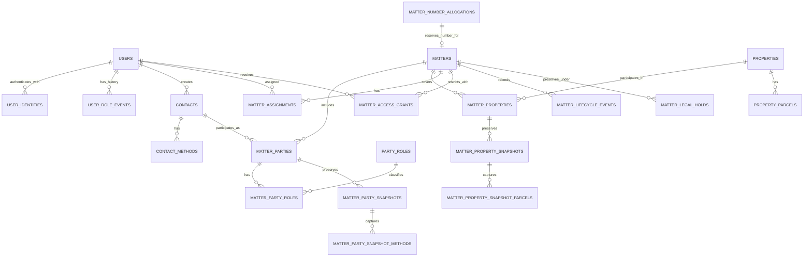
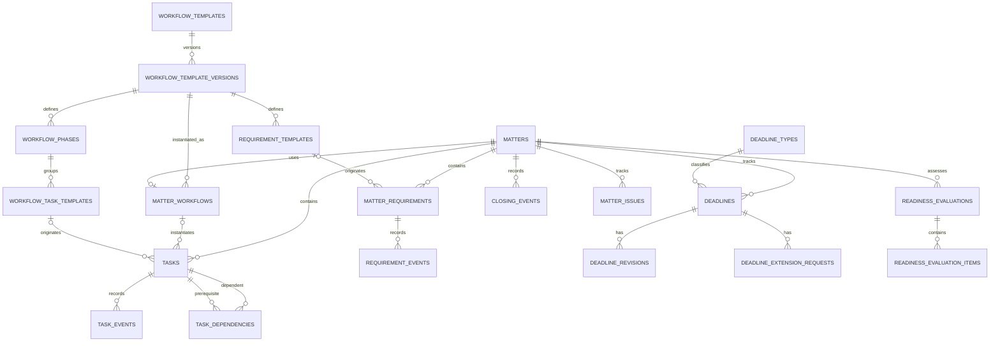
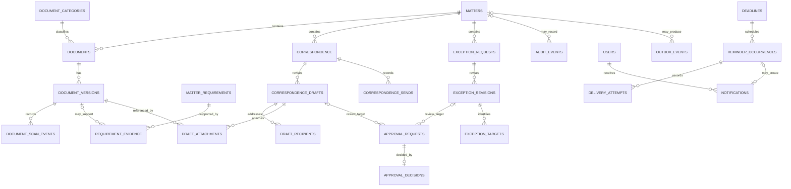

# Landholders Law — ERD and initial PostgreSQL DDL

**Status:** Proposed documentation for review, 2026-11-07. The [data dictionary](Landholders_Law_PostgreSQL_Data_Dictionary.md) is the detailed design source; the [data model](Landholders_Law_PostgreSQL_Data_Model.md) supplies business context. Neither this ERD nor the [SQL draft](schema/001_foundation_draft.sql) is a production migration. These diagrams show principal entities and relationships, not every column, actor, event, or FK in the dictionary. Cardinalities describe the physical design, including incomplete drafts; activation and authorization add service-level requirements.

## Identity, contacts, and matters

A matter can have multiple clients and properties; a contact or property can recur across matters. A draft may have neither. At most one primary client and primary property are proposed; activation requires a client, primary property and authorized primary attorney, but does not require a primary client. Snapshots preserve matter-time details when reusable records change. A reference allocation is independently committed before matter creation; a unique foreign key links at most one matter to each allocation. See the numbering decision below.

## Workflow, deadlines, and closing

An activated matter has exactly one compatible workflow; a draft can have none. Manual tasks need not originate from templates. Task dependencies, requirement evidence, and other matter-scoped links must not cross matters. Deadline revisions preserve effective values; an extension request does not itself change the deadline. Readiness evaluations are historical snapshots, distinct from current readiness.

## Documents, review, and notifications

Each approval request targets exactly one draft **or** exception revision; the diagram's two optional links must be combined with an exactly-one constraint. A document version represents an uploaded object or an external link, with mutually exclusive locators; upload scan history is separate. Recording a send and approval authorization require the service checks described in the dictionary. The application cannot prevent off-platform sending. Outbox delivery is asynchronous and does not guarantee exactly-once external delivery.

## First DDL draft

[001_foundation_draft.sql](schema/001_foundation_draft.sql) defines `users`, `user_identities`, `contacts`, `contact_methods`, `properties`, and `property_parcels`, plus an `updated_at` trigger. It targets PostgreSQL 16+ and follows the dictionary's single-firm, plural-table, bigint identity and app-generated UUID conventions. These are documentation artifacts, not migrations or evidence that a database is configured. [002_matters_draft.sql](schema/002_matters_draft.sql) adds number counters and allocations, matters, parties, property links, assignments, access grants and lifecycle events. Apply it after 001 only in a disposable test database; neither file is an Alembic migration.

Database checks enforce nonblank required names and locators, supported identity/contact kinds, Illinois properties, positive known unit counts and row versions, unique provider identities, and at most one preferred contact method per kind. Foreign keys restrict deletion and have supporting leading-column indexes. Email, names, addresses, phone numbers and PINs are deliberately not unique: normalization and duplicate handling are unresolved. Unknown property condominium status and unit count remain nullable; optional name parts, contact labels, parcel county and last verification represent missing or inapplicable information.

The application supplies UUIDs, increments `row_version` using optimistic concurrency, verifies Workspace membership and current authorization, controls sandbox identities, and writes audit/role history atomically. The trigger maintains `updated_at`; `now()` is transaction time. These service controls and the dictionary's immutable-history privileges are not implemented by this SQL. Access patterns supported initially are provider/issuer/subject lookup, case-insensitive email or contact-name equality, contact methods by contact, properties by city, and parcels by property. Lowercase B-tree indexes do not provide arbitrary substring search. The dictionary assumes fewer than 500 matters per year; child volumes and write rates are unknown, so indexes need measurement.

## Recommended database decisions

These decisions refine the dictionary for implementation and remain subject to production review. The following choices do not establish legal retention periods or approve workflow rules.

| Decision | Recommended approach and rationale |
| --- | --- |
| Matter references | Reserve `(year, sequence)` in an independently committed transaction; retain the allocation even if matter creation fails. The matter references the allocation by unique FK, avoiding a second copy of the year and sequence. Gaps are acceptable; an allocation cannot be used by two matters. This intentionally replaces the dictionary's duplicated matter reference columns. |
| Retention and deletion | Restrict normal application deletion of matter and historical records; deactivate users and contacts. Use explicit privileges and audited administrative processes, not cascading deletes. Determine retention, legal holds and eventual disposal with the firm before production. FK restrictions alone do not prevent deleting unreferenced records. |
| Contact matching | Store original values. Show candidate matches using case-insensitive name/email comparisons and normalized phone digits, with staff confirmation; do not enforce global uniqueness or automatically merge. Normalize for search only and do not overwrite the original. Do not treat a match as proof of identity. |
| Parcel matching | Preserve the original PIN and county; compare digit-only PINs as a candidate search within a known county and flag missing county. Do not enforce uniqueness or merge automatically: formatting, county rules and parcel changes need review. |
| Parties and property | Reusable master records and matter join rows are distinct; immutable matter-time snapshots remain necessary. Allow multiple clients and properties, at most one primary of each; activation requires at least one client and a primary property. |
| Access and history | Use explicit matter grants for restricted matters, preserve ended assignments and lifecycle events, and perform authorization in the service on every read and write. Current DDL alone does not restrict reads or guarantee append-only history; database privileges, audit writes and service checks are required. |
| Keys and indexes | Continue bigint identity for internal keys, application-supplied public UUIDs, named constraints, `timestamptz`, explicit restrictive foreign keys and indexed referencing columns. Add wider search indexes only after measuring representative queries. |

### Reservation protocol

The counter is a per-year row, not a PostgreSQL sequence. Within a **separate transaction**, the allocation service:

1. Takes a transaction-scoped advisory lock derived from the allocation token, then looks up the token. If found, returns that same allocation; retries must reuse the same token and originally selected year, even across New Year. Hash collisions merely serialize unrelated tokens. The caller must durably persist the token and chosen firm-local year before the first request; if an uncommitted attempt crosses New Year, the retry retains that chosen year.
2. If absent, validates the persisted year chosen in the configured firm timezone (currently America/Chicago), atomically increments that year's counter with `INSERT ... ON CONFLICT (reference_year) DO UPDATE SET last_value = matter_number_counters.last_value + 1 RETURNING last_value`, and inserts the allocation with the returned value and token. The counter row serializes concurrent allocations for the same year; different years can proceed independently. Both operations are in the reservation transaction.
3. Commits that transaction **before** exposing the reference or beginning matter creation. If the commit outcome is unknown, retry with the same token and read the result. A transaction rolled back before a reservation commits can reuse its counter value because no reference was issued. Once committed, the allocation is never deleted, changed or reissued, even if the subsequent matter transaction fails.
4. Creates the draft in a second transaction using the allocation's ID. A retry looks up the matter by its unique allocation ID and returns it rather than creating another. Use a stable matter public ID too. The FK and unique constraint prevent nonexistent allocations and duplicate attachment; service authorization must prevent claiming another request's allocation.

The initial counter insert uses `last_value = 1`. All allocators must follow this protocol, including the token lock before the counter lock. Use a dedicated reservation service/database role and revoke direct counter/allocation update and delete privileges from ordinary application roles; initial counter insert/update and allocation insert are limited to the reservation operation. The above is a design protocol, not executable code in this draft. Its transaction boundaries, token handling, recovery and privileges require real concurrent PostgreSQL tests before use. Do not infer no-reuse from the FK alone.

## Remaining work and verification

1. Draft matter party/property snapshots and their immutability controls; then workflow, deadlines, documents, requirements, approvals, audit and messaging. Implement same-matter composite FKs and transactional service operations as each domain is specified.
2. Turn approved SQL into Alembic migrations. Test reservations across concurrent calls, retries, failed matter inserts, lost commit responses and year boundaries; test invalid CHECK/UNIQUE/FK rows, assignment/grant races, activation and access restrictions. Inspect actual schema and query plans against representative fictional data.
3. Confirm retention and legal holds, approval and workflow rules, role grants, AWS integration and firm-specific operational decisions before production. Design and verify audit and immutable-history privileges; the draft does not implement these controls.

The drafts have not been applied to a database; no constraint, concurrency, migration, or query-plan tests are claimed.
