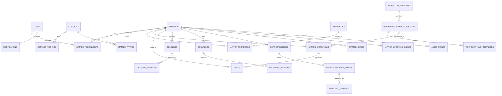

# Landholders Law — PostgreSQL Data Model & Architecture Specification

**Document ID:** LL-TECH-DB-001  
**Version:** 1.3 (AWS handoff and operational decisions)  
**Date:** 2026-11-07  
**Status:** Design baseline for review; not an executable migration or complete data dictionary  
**Scope:** Illinois real estate practice, internal staff MVP

> **Purpose:** Preserve the backend data-model decisions and implementation boundaries agreed during product design. This specification is intended to live in the application repository and serve as source material for the next deliverable: the full PostgreSQL data dictionary, followed by executable migrations and API contracts.

## 1. Executive summary

Landholders Law will use **PostgreSQL as the system of record** for its internal buyer and seller matter-management portal. The model is **matter-centric**: contacts and properties are reusable, but tasks, deadlines, documents, approvals, and operational activity are scoped to a particular legal matter.

The MVP should be implemented as a **modular monolith**, with transactional application services enforcing workflow, authorization, and legal-approval rules. Use normalized relational tables for business entities and relations; use `JSONB` selectively for versioned workflow rules, integration-specific metadata, and structured audit change payloads. Store uploaded file contents in private object storage, not as database blobs.

### Confirmed scope decisions

| Topic | Decision | Resulting design choice |
| --- | --- | --- |
| Practice and geography | Illinois real estate only for MVP | Buyer and seller matter types; Illinois property validation; no multistate or other practice-area abstractions required initially |
| Contacts | Reusable across matters | Independent `contacts` catalog and `matter_parties` join table |
| Workflow changes | Staff use published templates and may add individual tasks | Published, immutable template versions; instantiated tasks; manually sourced tasks; no staff template editor in MVP |
| Documents | Uploads **and** external links | Logical documents and version records supporting private storage keys or external URLs |

### Previously established business rules retained

1. Either authorized staff role may enter or change contractual deadlines; changes must be recorded.
2. All outgoing **legal correspondence** requires attorney approval. A material revision requires fresh approval; an attorney must record a nonmateriality decision linking any subsequent revision to the prior approval.
3. Standard tasks are generated from a published workflow; staff may add manual tasks.
4. A waiver of a currently required task needs justification and attorney authorization. Either role may first change a required task to optional with a recorded reason, without attorney authorization; this can remove the waiver control and is an explicit business decision.
5. Closing readiness may be overridden with documented attorney approval.
6. Either authorized staff role may close or reopen a matter, with a recorded reason.
7. Overdue deadline reminders recur **every business day until resolved**, using email and in-app notifications, subject to cancellation and access rules in §9.
8. Existing DocuSign files are represented by links with **manually tracked status** for the MVP; no live DocuSign synchronization is assumed.

## 2. Architectural boundaries

```text
Next.js / React staff portal
          |
          v
Amazon API Gateway
          |
          v
Python modular-monolith Lambda (container image)
  - Identity, authorization and matter operations
  - Workflow, deadlines, documents, approvals and audit
          |
          +-------- Amazon RDS for PostgreSQL (system of record)
          +-------- Private, versioned Amazon S3 (uploaded files)
          +-------- External provider URLs (e.g., DocuSign)
          +-------- Transactional outbox / background processing
                     - Amazon SES: email delivery
                     - Amazon SNS: internal notification events
                     - PostgreSQL: in-app notification records

EventBridge Scheduler ---> Lambda reminder processing
```

**Implementation posture:** Use a Python modular monolith deployed as a Lambda container image behind API Gateway, with Amazon RDS for PostgreSQL and S3 object storage. EventBridge Scheduler invokes reminder processing; SES sends email, SNS carries internal notification events, and in-app notifications are stored in PostgreSQL. The exact event routing, retries, scheduler failure monitoring and database connection management remain design work; SNS acceptance is not proof of email delivery. Use SQLAlchemy with Alembic migrations. Keep domain operations transactional and use the database outbox to coordinate asynchronous delivery. Avoid microservices and a separate workflow engine for MVP.

## 3. Modeling principles

- **Matter is the primary business aggregate.** A matter has parties, property references, workflows, tasks, deadlines, documents, correspondence, issues, and audit history.
- **Reusable master data is separate from matter-specific facts.** A `contact` or `property` can appear in multiple matters; historical transaction details should not silently change if shared master data changes.
- **Published definitions are not live execution state.** Templates and their versions are separate from materialized matter tasks.
- **Legal deadlines are not synonymous with task due dates.** Contractual cutoffs have their own entities and revision histories.
- **Approvals bind to an immutable target revision.** A later correspondence revision requires fresh approval or a recorded attorney decision that its changes are nonmaterial and the earlier approval remains effective.
- **Current state and history are separate.** Operational tables optimize queries; revision, lifecycle, and audit records retain the change history.
- **Relational integrity by default.** Use foreign keys, unique constraints, checks, partial indexes, and atomic transactions; use `JSONB` only where a stable relational structure is inappropriate.
- **Legal controls are enforced server-side.** Hiding UI actions is not a substitute for authorization or transaction checks.

## 4. Logical domains and proposed table inventory

The original inventory contained 27 core tables. The Q&A decisions below require additional concepts and likely tables; the inventory is provisional, not a fixed table count. Exact names, cardinalities, and whether a concept needs a separate table belong in the data dictionary.

| Domain | Original core tables | Count |
| --- | --- | ---: |
| Identity and contacts | `users`, `contacts`, `contact_methods` | 3 |
| Matter management | `matters`, `properties`, `matter_properties`, `matter_parties`, `matter_assignments` | 5 |
| Workflow | `workflow_templates`, `workflow_template_versions`, `workflow_task_templates`, `matter_workflows`, `tasks`, `task_dependencies` | 6 |
| Deadlines | `deadlines`, `deadline_revisions` | 2 |
| Documents | `documents`, `document_versions` | 2 |
| Correspondence and approvals | `correspondence`, `correspondence_drafts`, `approval_requests`, `closing_overrides` | 4 |
| Exceptions and lifecycle | `matter_issues`, `matter_lifecycle_events` | 2 |
| Audit and messaging | `audit_events`, `notifications`, `outbox_events` | 3 |
| **Total** | | **27** |

**Additional required concepts:** matter access restrictions and grants; phase definitions; matter-specific document/readiness requirements and their evidence; exception requests, affected requirements and conditions; correspondence materiality decisions and manual send records; closing appointments/outcomes; deadline reminder recipients and delivery attempts; and structured financial confirmations. Their physical table design is open. Dedicated title-order and integration-sync tables remain deferred; financial confirmations are in scope without building a ledger.

### 4.1 Identity and contacts

- `users`: internal authenticated people; account state and role/permission assignment (attorney vs. authorized operations staff). Identity-provider subject should be unique if external authentication is used.
- `contacts`: reusable persons and organizations; `contact_type` discriminates `person`/`organization` and supports an appropriate display name.
- `contact_methods`: zero or more email addresses, phone numbers, and communication preferences per contact.

**Rule:** A person can be a buyer on one matter and a seller on another; a brokerage, title company, or attorney may appear on many matters. Do not embed contact attributes directly into `matters` as the canonical identity record.

**Production identity:** Google Workspace is the production identity source; users in the firm’s Workspace may sign in without a prior application invitation. Provision a stable internal user record on first sign-in using the verified provider identity, not email alone. New users receive Operations by default; designated application administrators grant or remove Attorney authority, with history. Administrator is a separate permission from Attorney. Sandbox-only internal users do not establish a production password requirement. Disabled/removed Workspace users must lose access within 15 minutes while their records, assignments and historical decisions remain. Recheck authoritative account status at least within that window; if verification cannot succeed after the window, deny access until it does. The exact Workspace status-check mechanism remains implementation work. Provision the first named administrator through deployment configuration; audit subsequent administrator changes.

**Contact matching:** Show possible name/email matches and let staff choose whether to reuse a contact; never automatically merge based on a match. Snapshot each matter party’s name and contact methods and retain revisions. When a reusable contact’s email or phone changes, prompt staff to update affected active matters; preserve previous matter-specific values.

### 4.2 Matters and properties

- `matters`: legal engagement identifier, buyer/seller type, display title, lifecycle status, contract summary, dates, creation and update metadata, optimistic-lock version.
- `properties`: reusable Illinois property identity, street address, municipality, county, postal code, type, unit count, and optional PIN/metadata.
- `matter_properties`: matter-to-property relationship and designation of primary subject property; include transaction-time snapshot fields as necessary to preserve history.
- `matter_parties`: contact-to-matter relationship with role, for example buyer, seller, respective attorney, listing/buyer agent, lender, or title company.
- `matter_assignments`: staff responsibility on a matter, including primary attorney and operational assignee(s); preserve assignment history or validity intervals if reassignment accountability is necessary.

**Matter lifecycle and transaction milestones:** Keep file lifecycle separate from transaction outcome, hold state, and closing milestones. Record scheduled closing date/time/location, rescheduling, actual outcome and cancellation with history. A completed or canceled transaction remains an open file until obligations are completed or explicitly dispositioned. Either role may disposition work, but waiving a required task requires documented attorney authorization. Close/reopen requires an actor and reason; reopening resumes an open file without changing a canceled transaction to active or automatically resuming reminders stopped at cancellation. Prior dispositions persist; staff may reopen individual obligations with a recorded reason, actor and time. Define how these facts produce the mock’s Draft, Active, On Hold, Closing Scheduled, Post-Closing Pending, File Closed and Canceled labels, including precedence, in the data dictionary.

**Property scope:** `state = 'IL'` for the MVP. Property identification numbers should be text (not numbers), retaining formatting and leading zeros. A single property may be reused in multiple matters. Support multiple parcel/PIN records per property in the MVP; do not assume one PIN uniquely describes a transaction. Define county, normalization, duplicate handling and transaction-time parcel history in the dictionary.

**Matter reference:** Assign a firm-wide year-and-sequence reference such as `2026-0001` when a draft is first saved. Sequence independently by year; never reuse a reference, including for discarded drafts, and accept gaps. Allocate concurrently without duplicate references. Assume the firm timezone determines the year, pending confirmation; allocation and rollback behavior must preserve non-reuse.

**Activation minimum:** Require buyer/seller matter type, a named client person or organization, an assigned attorney, and a property with street address and Illinois city. Contact methods, PIN, unit count, contract dates and closing dates can be unknown. Drafts may be saved without meeting activation requirements.

**Rescheduling:** Recalculate only explicitly linked internal milestones, show proposed changes to staff for confirmation and record approved changes. Flag contractual deadlines for review; do not automatically change them.

### 4.3 Workflow and tasks

- `workflow_templates`: stable workflow identity (e.g., `IL_BUYER`, `IL_SELLER`) and matter type.
- `workflow_template_versions`: numbered, published or retired definition versions; publication timestamp and optional content hash.
- `workflow_task_templates`: standard task definitions tied to a specific template version; task key, description, sequence, required flag, applicability rule.
- `matter_workflows`: a matter's instantiated reference to one published template version and its execution metadata.
- `tasks`: actual units of staff work; standard tasks link to a template task, while staff-added tasks have `source = 'manual'` and no template task reference.
- `task_dependencies`: prerequisite edges between tasks on the **same matter**.

**Workflow cardinality:** Each activated matter has exactly one buyer or seller workflow; a purchase and sale are separate matters. Drafts may have none. Enforce retry-safe activation and prevent multiple instances.

**Publishing rule:** Once a template version is published, its definition and child task definitions are immutable. Revision creates another numbered version. Existing matters do not silently migrate or regenerate their tasks when a newer version is published. Retirement prevents new assignments, but retains history.

**Task state and phases:** Preserve phase identity on versioned definitions and instantiated work for phase progress and filters. Track applicability separately from work state, including no-longer-applicable, alongside ordinary work states and authorized waivers; reconcile exact states and transitions with the frontend before migrations. Waived required tasks need justification and an attorney authorization record. Either role may create a required custom task and may change a required task, including an incomplete one, to optional with a recorded reason and no attorney authorization. Preserve the change and acknowledge that it removes the required-task waiver control. Task due dates support an optional time.

**Applicability:** Simple constrained rules can live in `JSONB` and be evaluated using an allowlisted operator DSL; do not execute arbitrary code from stored rules. For example:

```json
{
  "all": [
    {"field": "property.city", "operator": "eq", "value": "Chicago"},
    {"field": "property.unit_count", "operator": "gte", "value": 2}
  ]
}
```

This is an **illustrative rule only**, not an authoritative statement of municipal legal requirements. Seed rules must be validated with the product owner/attorney. Evaluate rules as applicable, inapplicable, or unresolved when facts are unknown. Flag unresolved applicability for review; it blocks closing readiness if it could affect a closing requirement. Reevaluate after relevant fact changes; preserve task completion history while recording current applicability separately. If a previously inapplicable task becomes applicable again, reevaluate the existing task and flag it for staff review. Record the facts, rule/version, result, and actor or system action; ensure reevaluation does not duplicate tasks or erase completed work.

### 4.4 Deadlines

- `deadlines`: legally relevant dates, current status, type, date, optional cutoff time, timezone, responsible user, matter and supporting document references.
- `deadline_revisions`: append-only change records identifying previous and new deadline values, reason, actor, time, revision number, and optional supporting amendment.

Model contract dates as `DATE`, with optional `TIME` and timezone (normally `America/Chicago`), rather than assuming all deadlines expire at midnight. An unspecified cutoff remains unspecified; for operational display it becomes overdue on the next calendar day in the firm timezone. This is not a legal cutoff. Keep operational task due dates and optional times separate.

Staff enter and confirm contractual dates rather than automatically applying calculated dates. Record a linked document version and/or a written source note; allow saving without a source but flag it for follow-up. Deadline types use an administrator-managed list with Other. The contract’s actual weekend/holiday and cutoff interpretation remains subject to attorney review.

An authorized change to the current deadline and its revision must commit **atomically**. Use row locking or optimistic concurrency. Both authorized staff roles may revise dates. An extension request is separate from the effective date; reminders continue against the original date until the extension is confirmed and recorded. On Hold does not suspend unresolved deadline reminders. Cancellation and continuing-obligation reminders follow §9.

### 4.5 Documents

- `documents`: logical document identity, matter, classification/category, title, created by, and optional pointer to current version.
- `document_versions`: immutable historical versions, version number, storage kind (`upload`/`external`), S3-style private object key **or** external URL, relevant provider, checksum/size/content type as applicable, actor, timestamp.

Each document-version storage record must enforce **exactly one** of an uploaded storage key and an external URL; a logical document can associate both a retained file copy and an external link through separate records. Preserve a file copy when available, retaining the link. Flag a missing copy for follow-up but do not automatically block closing solely because the copy is missing when a link is available. Separately evaluate any applicable closing requirement. Require a valid non-null storage kind and nonblank locator. External DocuSign status is recorded manually, without claiming verification from the provider.

Document categories use an administrator-managed list with Other; retain historical category assignments when categories change. Store file bytes in private, versioned S3; record the object version identifier for each uploaded document version. Use short-lived signed URLs, validate file signature/size/type and scan uploads. Keep an upload unavailable for download until its scan passes, and record pending, passed and failed outcomes. Do not make storage keys publicly guessable download endpoints. Changes to a document should create a new version rather than overwrite history.

### 4.6 Correspondence and approvals

- `correspondence`: logical outgoing legal communication on a matter and its processing state.
- `correspondence_drafts`: immutable numbered content revisions used as approval targets.
- `approval_requests`: pending/approved/rejected decisions, requester, authorized reviewer, reason, timestamps, approval type, and a typed target reference.
- `closing_overrides`: documented attorney authorization to bypass explicitly identified readiness requirements, with justification.

For integrity, approval requests should have a **typed foreign-key target** (e.g., one nullable FK to a draft, task exception target, or closing override), plus a check that **exactly one target** is present. Generic `subject_type`/`subject_id` without a real foreign key is discouraged.

Outgoing legal correspondence requires an effective attorney approval. Preserve immutable revisions and the approval's exact target; a material change requires fresh approval. An attorney decides and records whether a later change is nonmaterial, linking the later revision, decision and prior approval so its continued effect is traceable. An attorney may approve their own draft. The immutable package includes content, subject, recipients, delivery method and exact attachment versions; any change creates a revision. Define the physical decision scope in the dictionary; do not infer that any change is automatically nonmaterial. Manually record the actual external send, including exact revision, effective approval/decision, sender, recipients, method, time and reference. The same effective approval may support multiple unchanged sends; record each separately. An attorney may revoke approval, blocking future sends under it while retaining prior sends and decisions. Historical correspondence entered from before launch may have unknown approval details; label it historical and retain available evidence without inventing approval. The MVP cannot prevent a send outside the app.

Represent each exception request and its revisions separately from mutable tasks, with typed links to the specific affected requirement(s), justification, conditions, decision and follow-up work. An attorney authorizes required-task waivers and closing exceptions. A closing exception covers only identified requirements and never falsely completes them. Changes to an affected requirement always flag its exception for review. When granting the exception, the attorney may select additional structured triggers, initially the closing date and linked document evidence, with an optional note; unrelated edits do not trigger review. Preserve the trigger selections and support expansion of the set. While review is pending it does not count toward readiness, which is Not Ready. Readiness is derived from applicable requirements, unresolved issues and effective exceptions, not an editable boolean.

### 4.7 Issues, history, notifications

- `matter_issues`: unresolved blockers such as title or financing issues; tracked owner, status, severity, and resolution history as needed.
- `matter_lifecycle_events`: close/reopen and other meaningful lifecycle transitions with actor, reason, and event time.
- `audit_events`: append-only activity history, including entity, action, actor, matter, request/correlation ID, changed fields, and timestamp. Sensitive values must be redacted.
- `notifications`: in-app notifications per recipient, type, related matter/deadline, seen/delivery status.
- `outbox_events`: transactional intent to send email/notifications, processed by a worker with idempotency and retry semantics.

An application audit trail is **not by itself tamper-proof** against privileged database administrators; if stronger evidentiary controls are required, replicate audit records to separately governed immutable storage.

### 4.8 Requirements, financial confirmations, and access

- Represent a matter-specific document requirement independently of an actual document, so missing, conditional, rejected and outstanding items exist before a file or link. Associate evidence with the requirement and preserve status and history. Model other closing requirements with stable identities that exceptions can target.
- Record manual financial confirmations with status, optional amount in integer USD cents, date, reference and optional supporting receipt. Support multiple confirmations of a kind and preserve corrections. This is not payment processing or a trust ledger.
- All authorized staff have matter access by default; matter-specific restrictions and explicit access grants are available. Any authorized staff member may change restrictions; record actor and time. A designated application administrator may restore access to a locked-out matter, with an audit record. Apply current permissions to matter data, documents, dashboard results and reminder delivery, including queued reminders. A deadline whose owner loses access is flagged as needing an authorized owner and displayed to staff with matter access until reassigned.
- Instantiate closing requirements per matter from attorney-reviewed, versioned buyer/seller templates. Either role may add a matter-specific requirement and decide whether it is required. Authorized staff must explicitly accept linked evidence; replacing or rejecting accepted evidence reopens the requirement and recalculates readiness while preserving history.
- Support non-waivable requirements: an unresolved one blocks readiness. Only an attorney may set or change non-waivable status, including on matter-specific requirements. Either role may change a required closing requirement to optional with a recorded reason, without attorney authorization, except that an attorney must first remove its non-waivable status. This can remove a readiness blocker and is an explicit business decision.
- Preserve matter-time party name and contact methods and their history while allowing reusable contacts to be updated; prompt staff before updating active matter details.

### 4.9 Existing matters at launch

Staff will enter existing active matters and their current state, assigning a new application reference and retaining the old file number as a searchable legacy reference. Either authorized role may enter historical completion and correspondence records with available evidence; entry remains available after launch and is clearly labeled and audited. Permit pre-launch work to be recorded as historically completed with an unknown completion date and a note; distinguish the actual event date, if known, from the entry time and user.

Historical correspondence with a known send date must predate the firm’s configured launch cutoff. An unknown send date is permitted only with a recorded attorney attestation that the correspondence predates launch. Administrators set or change the cutoff, with an audit record; cutoff changes preserve prior decisions and flag affected entries for attorney review. Do not fabricate historical approvals or use this path to represent new sends as pre-launch. A cutoff and attestation support review but cannot independently prove the truth of an entered date.

## 5. Key relationships and cardinalities



**Important additional relationships:** `tasks` link to a template-task definition when generated; `task_dependencies` join task-to-task; approvals may target tasks or overrides as well as correspondence; deadline revision records may reference supporting documents. The diagram also predates the new requirement, exception, access, send-record and financial-confirmation concepts in §4.8; it is illustrative and not a complete schema. These links will be explicit in the data dictionary.

## 6. Proposed constraints and integrity rules

| Invariant | Recommended mechanism |
| --- | --- |
| Unique matter number | `UNIQUE (matter_number)` |
| Only buyer/seller matters in MVP | `CHECK` or reference table for matter type |
| Illinois property records | `CHECK (state = 'IL')` |
| Contract price nonnegative | `CHECK (contract_price >= 0)` when non-null |
| Only one primary property per matter | Partial unique index on `matter_properties(matter_id)` where `is_primary` |
| Only one active primary attorney assignment per matter | Partial unique index with active/primary predicates |
| Reusable contacts with multiple roles | `matter_parties` FKs and a role-sensitive uniqueness rule |
| Unique workflow version per template | `UNIQUE (template_id, version)` |
| Unique template task key per version | `UNIQUE (template_version_id, task_key)` |
| No modifications to published definitions | Restrictive privileges/trigger plus service validation |
| Workflow template type must match matter type | Transactional validation or trigger |
| No task depending on itself | `CHECK (task_id <> depends_on_task_id)` |
| Dependencies belong to the same matter | Composite keys/FKs and indexed matter ID |
| No dependency cycles | Graph validation with serialization or appropriate locking to prevent concurrent conflicting inserts; a simple CHECK or unlocked transaction is insufficient |
| No mismatched matter and approval target | Typed and, where needed, composite foreign keys |
| One document storage mechanism per version | Exclusive-OR `CHECK` on `storage_key` vs. `external_url` |
| Unique version per document | `UNIQUE (document_id, version_number)` |
| Deadline current value and revision agree | Atomic update + insert, optionally enforced through trigger |
| All required legal correspondence approved | Authorized manual-send recording requires an approval of the exact revision or an attorney-recorded nonmateriality decision linking it to an effective prior approval |
| Required-task waiver and closing override approved | Service-level authorization with persisted decisions |
| Close/reopen requires a recorded reason | Authorized lifecycle transaction and nonblank reason validation |
| Audit history not modified by application users | Append-only permissions and enforcement |

**Composite-FK pattern:** For matter-scoped cross-references, add supporting `UNIQUE (matter_id, id)` on a referenced table and use `(matter_id, referenced_id)` foreign keys where useful. An ordinary FK on `id` alone proves existence, not that two records are in the same matter.

**Status consistency:** Use a small, controlled set of status values, agreed with the frontend/API contract. PostgreSQL `CHECK` constraints are easy initially; lookup tables may be preferable if statuses will expand. Do not independently redefine the same status names across frontend and database code.

## 7. Versioning and concurrency

| Record | Strategy |
| --- | --- |
| Workflow template | Numbered versions; published definitions immutable |
| Workflow task definition | Immutable once parent version is published |
| Matter workflow | Binds a matter to a particular published version; no automatic upgrade |
| Task | Mutable current state with audit/history events; retains template provenance |
| Deadline | Current row + append-only `deadline_revisions` |
| Document | Logical row + immutable `document_versions` |
| Legal correspondence | Logical row + immutable `correspondence_drafts`; approvals target revision ID |
| Matter lifecycle | Current status + append-only lifecycle events |

Include `row_version BIGINT NOT NULL DEFAULT 1` on mutable records at risk of concurrent edits (`matters`, `tasks`, `deadlines`, perhaps `documents`/approval request state). Update only when the expected version matches, incrementing on success. Zero rows updated is a conflict, not a silent last-writer-wins success.

**Business transaction examples** (all must be atomic):

1. **Create and activate matter:** allow a draft to exist before activation; on activation validate required facts, select a published workflow, instantiate or flag work and audit the result. Use transactional idempotency and uniqueness to prevent duplicate generated tasks.
2. **Revise deadline:** verify authorization/current version, update date, append revision and audit event, enqueue notification if needed.
3. **Approve correspondence:** verify current immutable draft, attorney role, outstanding request, then write approval decision and audit event.
4. **Record external correspondence sent:** confirm an effective approval for the exact revision or a recorded attorney nonmateriality decision linking it to the prior approval; atomically record the manual send and audit event. Sending occurs outside the MVP application.
5. **Override readiness:** validate blockers, persist specific authorization and reason, recompute readiness.
6. **Close/reopen:** validate role and nonblank reason, change status, add lifecycle event and audit event.

## 8. Indexing strategy

Plan initially for fewer than 500 new matters per year; task, document, notification and audit volumes still need estimates. Support partial-text search on matter reference, legacy reference, client name and property address; fuzzy matching is deferred. Start with query-oriented B-tree/partial indexes, then measure using `EXPLAIN (ANALYZE, BUFFERS)` under representative data volumes.

| Table | Index pattern | Primary use |
| --- | --- | --- |
| `matters` | `(status, updated_at DESC)` | Dashboard / active matters |
| `matters` | `(matter_type, status)` | Buyer/seller filters |
| `contacts` | expression on `lower(display_name)` | Contact lookup |
| `matter_parties` | `(contact_id, matter_id)` | Contact history |
| `tasks` | `(assigned_to, due_on)` partial over open statuses | My tasks |
| `tasks` | `(matter_id, status)` | Matter task board |
| `deadlines` | `(due_on, matter_id)` partial over unresolved statuses | Approaching/overdue deadlines |
| `documents` | `(matter_id, category)` | Matter document list |
| `approval_requests` | `(requested_at)` partial where pending | Attorney approval queue |
| `audit_events` | `(matter_id, occurred_at DESC)` | Activity timeline |
| `notifications` | `(recipient_user_id, created_at DESC)` | User inbox |
| `outbox_events` | `(status, available_at)` partial where queued/retry | Worker pickup |

Example (illustrative; column names and statuses will be finalized in the data dictionary):

```sql
CREATE INDEX idx_tasks_active_assignee
  ON tasks (assigned_to, due_on)
  WHERE status IN ('pending', 'in_progress', 'blocked');

CREATE INDEX idx_deadlines_unresolved
  ON deadlines (due_on, matter_id)
  WHERE status IN ('pending', 'overdue');

CREATE INDEX idx_approvals_pending
  ON approval_requests (requested_at)
  WHERE status = 'pending';

CREATE INDEX idx_audit_matter_timeline
  ON audit_events (matter_id, occurred_at DESC);
```

PostgreSQL does **not** automatically index referencing FK columns; index frequently joined and delete-checked relationships deliberately. Evaluate `pg_trgm` for fuzzy names/addresses if needed, rather than adding a standalone search service in the MVP.

## 9. Notifications and background jobs

- Every business day, a worker identifies unresolved overdue deadlines and attempts email and in-app reminders.
- Business days are Monday–Friday excluding holidays in an administrator-managed firm calendar. Overdue reminders default to 9:00 a.m. America/Chicago, configurable by the firm. Advance reminders default to 7, 3 and 1 calendar days before the due date, configurable, and are sent on the scheduled calendar day including weekends and holidays. Administrators manage firm-wide scheduling, with change history.
- The transactional outbox records notification intent in the same transaction as the event requiring it, avoiding lost sends after database commit.
- The deadline owner receives reminders; additional recipients are configurable. If the owner is missing or inactive, display the deadline on the authorized dashboard until someone claims it. Do not send or disclose restricted matter details to recipients without current access.
- Cancellation stops all existing deadline reminders. Staff may explicitly set up or reactivate reminders for continuing obligations, with actor and time recorded. On Hold does not stop unresolved reminders.
- Send at most one reminder per deadline, recipient, channel and local calendar day, including when intervals coincide or a deadline is revised after a reminder was sent. Preserve the triggering intervals and deadline revision separately; do not include reminder type or revision in a uniqueness key if doing so permits a second same-day notice. Recheck deadline revision, state, cancellation/reminder eligibility and current recipient access before dispatch.
- A revised date suppresses unsent notices for the old revision and schedules eligible future reminders. Do not backfill advance intervals already past when a deadline is created or revised. A reminder missed due to an outage may be retried while relevant until the end of its scheduled local calendar day. Later eligible overdue days have separate occurrences.
- EventBridge Scheduler invokes the Lambda; retain processing and delivery attempts, retry automatically, and alert an administrator after retries are exhausted. Monitor invocation/scheduler failures independently. Define the event routing, retry limits and alert destination during implementation.
- Reminder emails contain a minimal notice and link; viewing details requires sign-in and current matter access. Track delivery attempts and errors, distinguishing application enqueue, SNS event processing, SES acceptance and known delivery outcomes. Use provider idempotency where available and define retries and uncertain delivery outcomes; exactly-once delivery across an external email service cannot be assumed.

## 10. Security, privacy, and retention

- **Authorization:** Verify user and matter-scoped permissions on the server for all reads, changes, approvals, document access and reminder delivery. All authorized staff have access by default; any authorized staff member may apply or change an audited matter-specific restriction. Only authorized attorneys may approve legal correspondence and closing overrides.
- **Database access:** Use least-privilege application credentials distinct from migration/admin credentials; protect backups and connections.
- **Document storage:** Private bucket, encryption, controlled signed access, upload validation and malware scanning. Treat external URLs as references, not authenticated provider status.
- **Audit:** Preserve actor identity, request ID, event time and affected resource; redact secrets and avoid logging document text unnecessarily.
- **Deletion:** Retain closed-matter records and documents until the firm establishes and approves a retention policy. Do not cascade-delete matter history inadvertently; define purge and archive behavior only after that policy is approved.
- **Future organizations:** MVP is one firm; do not introduce pervasive multi-tenant complexity without a concrete requirement. If multi-firm use becomes a roadmap goal, plan an `organization_id` migration across domain tables and isolation policies.
- **Legal requirements:** The product owner/attorney must validate workflow content, deadline semantics, retention rules, and approval policies before production release.

## 11. Migration plan and dependency order

| Batch | Content | Tables / actions |
| --- | --- | --- |
| 01 | Database foundation | Extensions, naming conventions, app/migration roles, common helpers |
| 02 | Users and contacts | `users`, `contacts`, `contact_methods` |
| 03 | Matter foundation | `matters`, `properties`, `matter_properties`, `matter_parties`, `matter_assignments` |
| 04 | Workflow definitions | `workflow_templates`, `workflow_template_versions`, `workflow_task_templates` |
| 05 | Workflow execution | `matter_workflows`, `tasks`, `task_dependencies` |
| 06 | Legal deadlines | `deadlines`, `deadline_revisions` |
| 07 | Document records | `documents`, `document_versions` |
| 08 | Review and exceptions | `correspondence`, `correspondence_drafts`, `closing_overrides`, `approval_requests`, `matter_issues` |
| 09 | History and messaging | `matter_lifecycle_events`, `audit_events`, `notifications`, `outbox_events` |
| 10 | Seed and validate | Buyer/seller published v1 templates, tests, initial indexes, benchmarks |

**Planning note:** This original batch list is incomplete after the Q&A: it must include the additional concepts in §4.8 and their dependencies once the dictionary settles the physical tables. Do not treat it as a migration-ready order.

**Circular dependency note:** If `documents.current_version_id` references `document_versions`, or `deadlines.supporting_document_id` references `documents`, add those references in a separate `ALTER TABLE` after both sides exist, or avoid the circular pointer through a query. The actual migration graph should be derived from the finalized dictionary rather than assumed from this high-level sequence.

**Database target and tooling:** Amazon RDS for PostgreSQL 16 or newer, SQLAlchemy and Alembic for the Python backend. Check migration SQL into version control and test against a real PostgreSQL instance; the Python web framework remains open. Enable seven days of RDS automated backups and test restores. Configure S3 versioning and retain prior object versions; database backups and S3 recovery are separate from the firm’s record-retention policy.

## 12. Acceptance and integration tests

The baseline should not be considered implemented until the following pass. The latest handoff decisions add these cases:

- [ ] Activation rejects missing matter type, named client, assigned attorney or Illinois street address/city, but allows missing contact methods, PIN, unit count and contract/closing dates.
- [ ] A disabled Workspace user loses access within 15 minutes; unverifiable account state beyond that window fails closed, and named initial-administrator provisioning is auditable.
- [ ] S3 object versions are retained and referenced by uploaded document versions; downloads are blocked until malware scanning passes.
- [ ] Each deadline/recipient/channel/local-day has at most one reminder, including revisions and multiple intervals. Revised dates suppress stale pending notices; already-past advance intervals are not backfilled. Outage retries stop at the end of the scheduled local day.
- [ ] EventBridge scheduler failures and exhausted retries alert administrators; SES email delivery and SNS internal events do not imply a successful recipient delivery. In-app records remain in PostgreSQL.
- [ ] Historical correspondence is dated before the configured cutoff or has an attorney’s pre-launch attestation for an unknown date; changing the audited cutoff flags affected records without silently reclassifying them.
- [ ] A change to an exception’s affected requirement always flags review; selected supported facts also trigger review. A task becoming applicable again reuses the existing task and preserves its completion and applicability history.
- [ ] Reopening a file does not reactivate a canceled transaction or restart its reminders; dispositions persist, and reopening an obligation records a reason, actor and time.
- [ ] Automated RDS backups retain seven days, restores are tested, and S3 version recovery is tested separately.

Earlier Q&A acceptance cases:

- [ ] A verified Workspace user is provisioned as Operations on first sign-in; only an administrator grants Attorney, and deactivated accounts lose access while retaining history. Sandbox users do not create production password requirements.
- [ ] Matter references are allocated when drafts are saved, are unique under concurrent allocation and never reused after abandonment or rollback; each activated matter has one workflow.
- [ ] A property supports multiple text PINs; possible contact matches are shown without automatic merging, and active-matter contact updates are prompted and historically preserved.
- [ ] Date-only deadlines show no invented cutoff and become operationally overdue the next local day; an unsourced deadline is flagged and still monitored. Advance and overdue schedules honor their distinct calendar rules.
- [ ] Changing a required task or waivable closing requirement to optional is permitted to either role with an audit reason; a non-waivable requirement cannot become optional until an attorney removes its non-waivable status.
- [ ] An authorized staff member accepts evidence explicitly; replacing or rejecting it reopens its requirement and recalculates readiness. Non-waivable unresolved requirements block readiness.
- [ ] A rescheduled closing proposes changes only to linked internal milestones for staff confirmation; contractual dates remain unchanged and are flagged for review.
- [ ] The approved package contains content, subject, recipients, method and exact attachment versions; revocation prevents further use and each permitted send is recorded separately.
- [ ] Existing matters support historical completions and correspondence with unknown event or approval details without inventing records or permitting new unapproved sends.
- [ ] An administrator can recover locked-out matter access with audit, and users who lose access cannot receive restricted matter details or remain silently responsible for a deadline.

- [ ] A material correspondence change requires fresh approval; only an attorney can record a nonmaterial decision linking a later revision to the earlier approval. Self-approval and a manual send record preserve the exact revision and decision.
- [ ] A document requirement appears before evidence exists; an external link and retained upload can coexist, and a missing copy is flagged without automatically blocking closing.
- [ ] An exception names specific requirements and conditions; a relevant fact change flags it for review and makes readiness Not Ready until reviewed.
- [ ] Unknown conditional facts produce unresolved applicability; potentially closing-relevant uncertainty blocks readiness. Reevaluation preserves history and does not duplicate tasks.
- [ ] Transaction closing or cancellation is distinct from file closure; all open obligations are completed or explicitly dispositioned, and required-task waivers have attorney authorization.
- [ ] Cancellation stops existing reminders; explicit continuing-obligation reminders can be set up. On Hold does not stop unresolved reminders, and a pending extension does not change the effective date.
- [ ] Reminders deduplicate per recipient and channel, and dispatch rechecks current deadline state and access. An unowned or inactive-owner deadline is visible for claiming on the authorized dashboard.
- [ ] Restrictions are auditable and enforced for matter access, documents, dashboard and queued reminders; no restricted details reach unauthorized recipients.
- [ ] Financial confirmations retain status, amount, date, reference and optional receipt; changing a reusable contact preserves matter-time history.

Existing acceptance cases:

- [ ] One contact participates in multiple matters with distinct roles.
- [ ] One property can appear in multiple matters without rewriting historical transaction snapshots.
- [ ] Illinois-only property validation rejects non-Illinois properties.
- [ ] Buyer matters cannot instantiate seller-only workflow templates, and vice versa.
- [ ] Only published workflow versions can be instantiated.
- [ ] Published template and task definitions cannot be modified; existing matters keep their originally assigned version.
- [ ] Staff can add individual tasks without modifying the published template.
- [ ] Required task waivers require a documented approval and cannot be silently marked complete.
- [ ] Cross-matter task dependencies are rejected; dependency cycles are rejected.
- [ ] A deadline update preserves old values, records the reason and actor, and handles simultaneous writes safely.
- [ ] Overdue reminders recur on each eligible business day and are deduplicated per recipient, channel and date, subject to cancellation and access rules.
- [ ] Uploaded document and external-link versions are both valid; a version cannot claim both storage kinds.
- [ ] DocuSign link status stays explicitly manual in the MVP.
- [ ] A revised correspondence draft cannot be recorded sent under an old approval without an attorney-recorded nonmateriality decision; a material revision needs fresh approval.
- [ ] Only attorneys can authorize legal correspondence and closing overrides.
- [ ] A readiness override identifies the specific bypassed requirements and reason.
- [ ] Matter closure and reopening always retain a reason and actor.
- [ ] Audit and lifecycle records cannot be modified using normal application privileges.
- [ ] Document download endpoints enforce matter access and do not expose long-lived public object URLs.

## 13. Remaining work and decisions

The business decisions above are sufficient to start a **draft data dictionary**. They do not yet constitute a migration-ready schema or approved workflow content. The following items have different decision points:

### Before finalizing production migrations

1. **Data dictionary and invariants:** Finalize physical tables, types, nullability, same-matter foreign keys, named constraints and indexes, statuses, transition rules, deletion behavior, concurrency and audit enforcement. Decide internal IDs and exact PostgreSQL types; validate against PostgreSQL 16 or newer.
2. **Workflow and readiness definitions:** An attorney and Operations must review buyer/seller task phases, applicability rules and facts, required and non-waivable requirements, evidence criteria, dependencies, initial category/type lists and closure dispositions. Do not publish guessed legal rules. Define which exception facts trigger review and what happens to completed work after reevaluation.
3. **Identity and access implementation:** Implement Google Workspace organization membership and stable subject verification, named first-admin bootstrap, administrator permissions and authoritative identity disablement checks within 15 minutes with fail-closed behavior. Specify grants, revocation, lockout recovery and consistency with notification access.
4. **Operations and lifecycle:** Define state precedence and transitions, task and deadline timezones and cutoff semantics, source snapshots and evidence reacceptance rules. Finalize retry limits, delivery uncertainty, reminder schedule-change races and how administrators address exhausted retries.
5. **Infrastructure implementation:** Choose the Python web framework and AWS event routing, email delivery monitoring, scanning service, alert destination, Lambda/RDS connection management and test/deployment setup. Validate provider retry/idempotency behavior, seven-day database backup and restore, S3 recovery, recovery-time objectives and access to stored objects. Administrators manage calendar holidays and firm-wide reminder schedules.
6. **Security and retention:** Identify sensitive fields, redaction, encryption, access logging, retention and legal holds; approve retention/deletion policy before any purge. Define authorization and control review for the intentional ability to change required items to optional without an attorney.
7. **Historical conversion:** Define legacy-number matching, the import method, validation and cutover date; design the administrator-managed cutoff and attorney-attestation records and safeguards. Preserve unknown prior dates and approvals without treating historical statements as new approvals.

### Remaining design details for the dictionary

- Contact person/organization fields, preferred methods, duplicate matching and snapshot capture; property/PIN county, normalization, address and parcel snapshots.
- Exact approval and exception tables, correspondence revision/materiality/revocation mechanics, send recipients, multiple evidence/version relationships and external-link/file identity.
- Reminder configurations, one-per-day occurrence and per-recipient/channel delivery records, business-calendar rules, same-day revision races and handling of unknown or inaccessible owners.
- Source and correction history for deadline revisions and financial confirmations; money is optional USD integer cents. Confirm data types, defaults, supported statuses and historical precision.
- Search uses partial matter reference, legacy reference, client name and property address. Confirm collation, index choice and representative volumes using `EXPLAIN`; fewer than 500 new matters per year is an assumption, not a benchmark.
- Encode the agreed activation minimum with draft-compatible nullability and transactional activation validation; define precise timestamp behavior when task or deadline time is unspecified.

## 14. Next deliverable — full PostgreSQL data dictionary

The proposed [MVP data dictionary](Landholders_Law_PostgreSQL_Data_Dictionary.md) is available for review; it is not approved executable DDL.

**Do not treat the inventory in this document as a completed data dictionary.** The next artifact should specify, for **each finalized table and relationship**, including the additional concepts in §4.8:

- Table purpose and owning application domain.
- Every column name, PostgreSQL type, default, nullability, validation rule, and sensitivity classification.
- PK, FK, unique, check, and exclusion constraints; delete/update behavior.
- Composite keys and same-matter referential integrity mechanisms.
- Allowed status values and transition rules.
- Index definitions, including partial predicate and expected query.
- Historical/versioning behavior and write authorization.
- Example record, migration dependencies, and acceptance tests.

After approving that dictionary, generate executable migrations, seed workflow definitions, and service/API contracts. Avoid creating migrations independently of the reviewed dictionary.

---

## Appendix A — Selected illustrative SQL patterns

> The following are **patterns**, not an executable complete schema. Referenced tables/columns must exist and the database contract must be finalized first.

```sql
-- Reusable buyer/seller template version identity
CREATE TABLE workflow_templates (
    id UUID PRIMARY KEY DEFAULT gen_random_uuid(),
    code TEXT NOT NULL UNIQUE,
    name TEXT NOT NULL,
    matter_type TEXT NOT NULL CHECK (matter_type IN ('buyer', 'seller')),
    created_at TIMESTAMPTZ NOT NULL DEFAULT now()
);

CREATE TABLE workflow_template_versions (
    id UUID PRIMARY KEY DEFAULT gen_random_uuid(),
    template_id UUID NOT NULL REFERENCES workflow_templates(id),
    version INTEGER NOT NULL CHECK (version > 0),
    status TEXT NOT NULL DEFAULT 'draft'
      CHECK (status IN ('draft', 'published', 'retired')),
    published_at TIMESTAMPTZ,
    UNIQUE (template_id, version),
    CHECK (
      (status = 'draft' AND published_at IS NULL)
      OR (status IN ('published', 'retired') AND published_at IS NOT NULL)
    )
);

-- Versions must have exactly one storage mechanism.
-- Use this as a table CHECK when document_versions is defined.
CHECK (
  (storage_kind = 'upload' AND storage_key IS NOT NULL AND external_url IS NULL)
  OR
  (storage_kind = 'external' AND external_url IS NOT NULL AND storage_key IS NULL)
)

-- At most one primary property per matter.
CREATE UNIQUE INDEX uq_matter_primary_property
  ON matter_properties (matter_id)
  WHERE is_primary;
```

## Appendix B — Repository placement suggestion

Recommended location: `docs/architecture/postgresql-data-model.md`. Link it from the repository's architecture index or README, then develop the data dictionary as `docs/architecture/postgresql-data-dictionary.md` alongside it.
